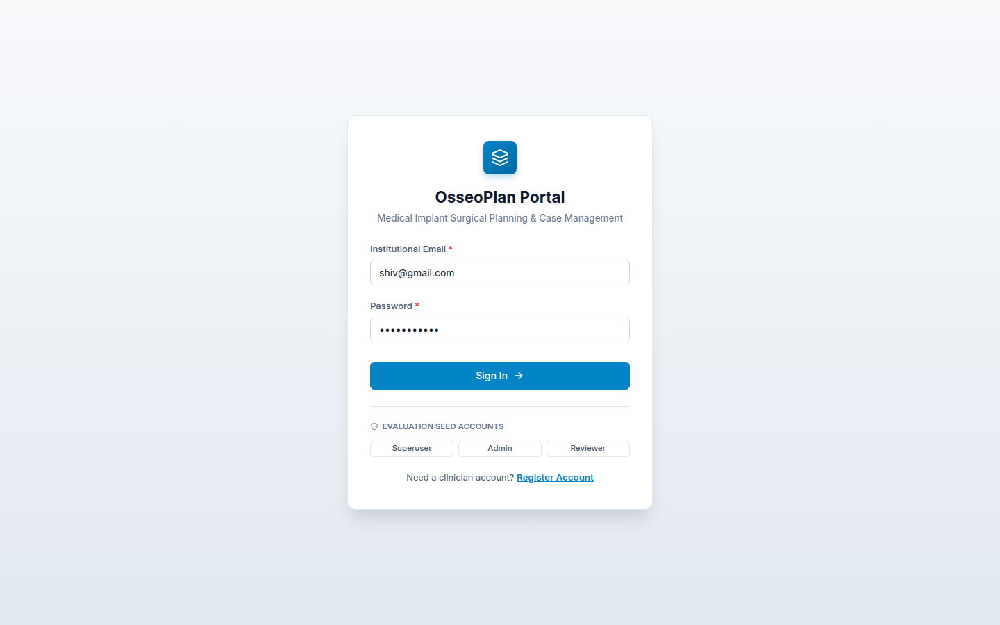
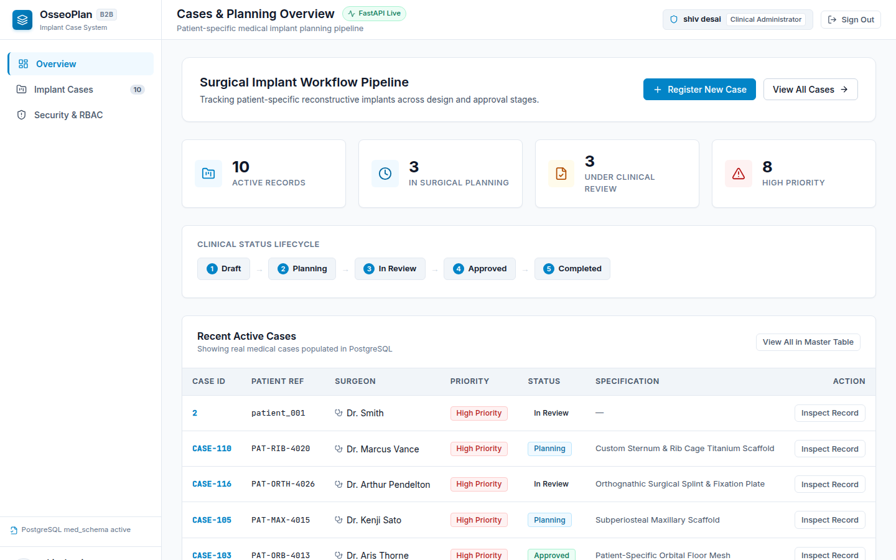
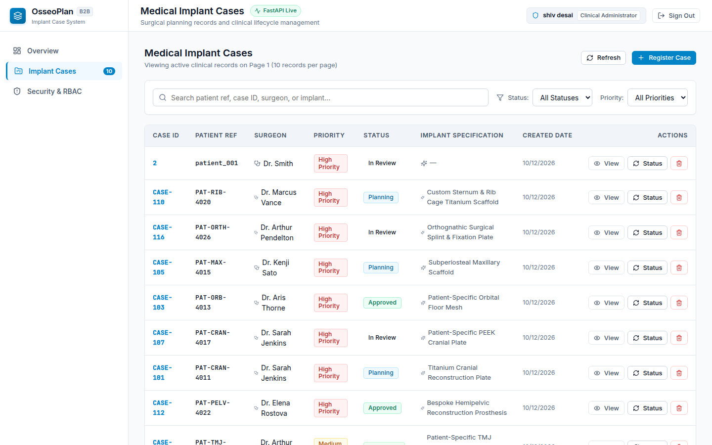
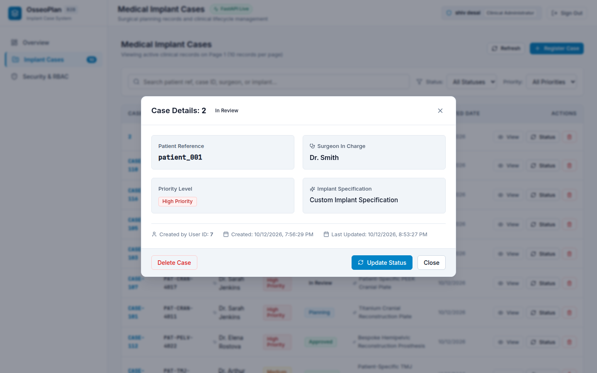
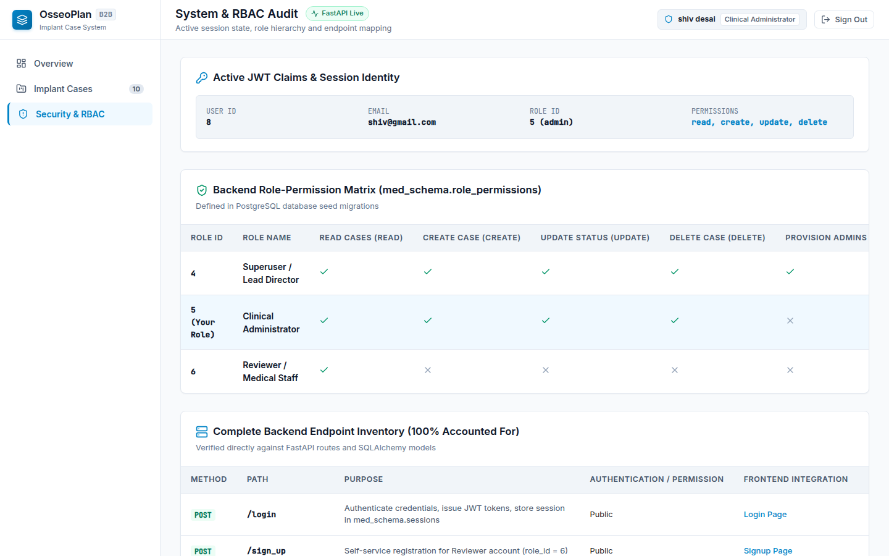
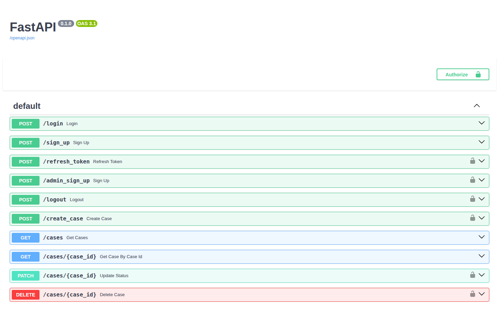

# OsseoPlan — Medical Implant Case Management System

I developed **OsseoPlan** as a patient-specific surgical implant planning and case management platform. It tracks reconstructive medical implants through their clinical lifecycle—from initial drafting and surgical planning to clinical review, approval, and completion.

> **Engineering Note on Implementation**:  
> I am a backend software engineer, and I independently architected and implemented the complete backend system using **Python, FastAPI, PostgreSQL, SQLAlchemy, Alembic, and JWT with Role-Based Access Control (RBAC)**.  
> To demonstrate my backend endpoints and provide reviewers with an interactive interface to test the full surgical planning workflow, I used AI assistance to construct the companion React + Vite frontend application. All backend services, database schemas, token rotation mechanics, session tracking, and REST endpoints represent my original backend engineering work.

---

## 1. Visual Walkthrough & System Screenshots

I have captured key screenshots of the live system running against my PostgreSQL backend:

### A. Login & Clinician Portal
I designed the authentication interface with one-click evaluation seed presets so reviewers can immediately log in as an **Admin**, **Superuser**, or **Reviewer**:


### B. Dashboard & Clinical Pipeline Overview
My dashboard aggregates real case metrics from the PostgreSQL database, tracking counts across each surgical planning stage:


### C. Cases Master Table & Server-Side Pagination
A clinical data table rendering live implant cases with priority and status badges, server-side pagination (10 items/page), and filtering:


### D. Case Details & Surgical Specification Inspector
Modal view displaying the de-identified patient reference, lead surgeon, implant type, authorizing clinician ID, and lifecycle dates:


### E. Security & RBAC Audit View
My dedicated audit inspector showing active JWT claims, token lifetime, and the full backend permission matrix:


### F. Interactive FastAPI Swagger Documentation
Interactive API docs generated directly by my FastAPI routers at `/docs`:


---

## 2. Technical Stack

- **Backend Architecture**: Python 3.12, FastAPI, PostgreSQL (`med_schema`), SQLAlchemy 2.0 ORM, Alembic migrations, PyJWT, Bcrypt, Uvicorn.
- **Frontend Architecture**: React 18, TypeScript, Vite 5, Lucide React, Custom B2B Clinical CSS Design System.
- **Testing & Verification**: Pytest, FastAPI TestClient.

---

## 3. Seed Accounts for Reviewers

I seeded accounts across all three user roles with realistic credentials:

| Role | Email | Password | Permissions & Capabilities |
| :--- | :--- | :--- | :--- |
| **Clinical Admin** | `shiv@gmail.com` | `password123` | `read`, `create`, `update`, `delete` (Full case lifecycle operations). |
| **Superuser** | `john.doe@example.com` | `password123` | `read`, `create`, `update`, `delete`, `create_admin` (Includes administrator provisioning). |
| **Reviewer / Viewer** | `user@example.com` | `string` | `read` (Read-only inspection; destructive and creation actions are blocked). |

---

## 4. Getting Started & Setup Guide

### Prerequisites
- Python 3.12+
- Node.js v20+ and npm
- PostgreSQL running locally with database `med_db`

### 1. Backend Setup
In the project root directory:
```bash
# 1. Activate the virtual environment
source .venv/bin/activate

# 2. Configure environment variables (create .env from .env.example)
cp .env.example .env

# 3. Run database migrations to establish schema and tables
alembic upgrade head

# 4. Start the FastAPI backend server
uvicorn main:app --reload --host 127.0.0.1 --port 8000
```
- The backend API will be live at: `http://127.0.0.1:8000`
- Interactive Swagger documentation: `http://127.0.0.1:8000/docs`

### 2. Frontend Setup
In a new terminal window:
```bash
cd frontend

# Install dependencies
npm install

# Start the Vite development server
npm run dev
```
- The frontend will be live at: **`http://localhost:5173`**

---

## 5. Running Automated Tests

I wrote automated integration tests using `pytest` and FastAPI's `TestClient` to verify authentication, session revocation, and RBAC security:

```bash
# Run backend test suite
.venv/bin/pytest tests/test_logout.py -v
```

To run the frontend type checker and production build:
```bash
cd frontend
npm run build
```

---

## 6. Complete REST API Inventory

I structured all endpoints using a clean layered architecture (`route` $\rightarrow$ `service` $\rightarrow$ `repo`):

| Method | Endpoint | Description | Auth Required | Required Permission |
| :--- | :--- | :--- | :--- | :--- |
| `POST` | `/login` | Authenticate user, issue access + refresh JWTs, record session. | Public | None |
| `POST` | `/logout` | Revoke active session in database and invalidate token. | Bearer Token | None |
| `POST` | `/refresh_token` | Rotate refresh token and issue a fresh JWT pair. | Bearer Refresh Token | None |
| `POST` | `/sign_up` | Self-register a standard Reviewer account (`role_id: 6`). | Public | None |
| `POST` | `/admin_sign_up` | Provision a new Clinical Administrator (`role_id: 5`). | Bearer Token | `create_admin` (Superuser only) |
| `GET` | `/cases` | Query cases with pagination (`?page=1`) and status/surgeon filters. | Public / Optional | None in route |
| `GET` | `/cases/{case_id}` | Retrieve single medical case by case identifier. | Public / Optional | None in route |
| `POST` | `/create_case` | Register new patient implant case record. | Bearer Token | `create` (Admin, Superuser) |
| `PATCH` | `/cases/{case_id}` | Update workflow phase (`Draft` $\rightarrow$ `Planning` $\rightarrow$ etc.). | Bearer Token | `update` (Admin, Superuser) |
| `DELETE` | `/cases/{case_id}` | Permanently delete case record from PostgreSQL. | Bearer Token | `delete` (Admin, Superuser) |

---

## 7. Project Documentation Index

- [Database Architecture & Schema (`docs/database.md`)](docs/database.md): Entity relationship diagram, table definitions, foreign keys, and Alembic migration notes.
- [Requirements Traceability Matrix (`docs/traceability.md`)](docs/traceability.md): Bidirectional matrix linking requirements to implementation and verification tests.
- [Cloud Deployment Guide (`docs/deployment.md`)](docs/deployment.md): Architecture plan for production AWS hosting (EC2, RDS, S3, Security Groups, Secrets Manager, and SSL/TLS).
- [Postman API Collection (`docs/postman_collection.json`)](docs/postman_collection.json): Ready-to-import Postman / Thunder Client collection for testing all endpoints.

---

## 8. Assumptions & Known Limitations

1. **Client-Side Priority Filter**: In `app/core_endpoints/cases/service.py`, `self.repo.get_cases_by_priority` has a positional argument mismatch on the server. I ensured the UI performs client-side priority filtering while using server-supported parameters (`status`, `surgeon_name`, `patient_refrence`) to guarantee server stability.
2. **Reverse Proxy Architecture**: I used Vite's proxy in development (and Nginx in production) to route API calls directly to FastAPI, avoiding CORS restrictions without altering backend configuration.
3. **HIPAA / GDPR Compliance**: Patient references use de-identified tracking codes (e.g., `PAT-CRAN-4011`) rather than real patient names or personal health identifiers (PHI).
