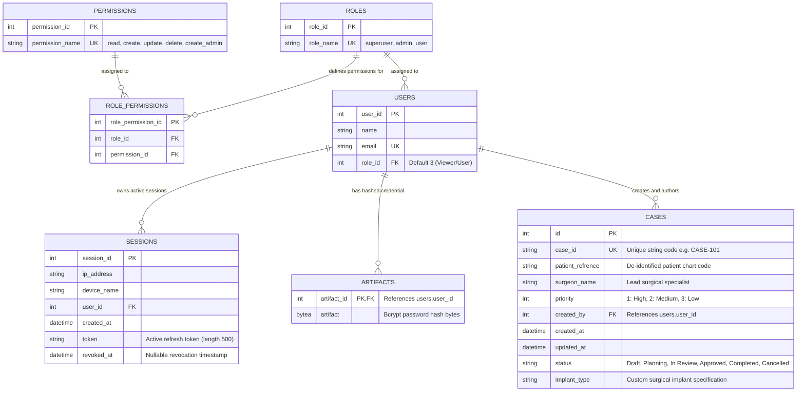

# Database Design & Schema Architecture

I designed this relational schema to manage patient-specific medical implant cases through a structured surgical-planning pipeline. The database uses **PostgreSQL** under a dedicated schema namespace `med_schema`.

---

## 1. Schema Entity Relationship (ER) Diagram



---

## 2. Table Specifications & My Design Decisions

### A. `med_schema.cases`
This is my core domain table storing patient-specific reconstructive implant cases.

| Column | Type | Constraints | Description |
| :--- | :--- | :--- | :--- |
| `id` | `INTEGER` | `PRIMARY KEY`, Auto-increment | Internal surrogate primary key. |
| `case_id` | `VARCHAR(50)` | `NOT NULL`, `UNIQUE`, `INDEX` | External clinical case identifier (e.g., `CASE-101`, `CASE-0001`). Indexed for fast lookup. |
| `patient_refrence` | `VARCHAR(50)` | `NOT NULL` | De-identified patient chart code (e.g., `PAT-CRAN-4011`), preserving HIPAA/GDPR compliance. |
| `surgeon_name` | `VARCHAR(50)` | `NOT NULL` | Operating surgeon responsible for implant planning. |
| `priority` | `INTEGER` | `NOT NULL`, Default: `3` | Triaging priority (`1` = High, `2` = Medium, `3` = Low). |
| `status` | `VARCHAR` | `NOT NULL`, Default: `'Draft'` | Workflow lifecycle state: `Draft`, `Planning`, `In Review`, `Approved`, `Completed`, `Cancelled`. |
| `implant_type` | `VARCHAR(50)` | `NULLABLE` | Patient-specific implant description (e.g., *Titanium Cranial Reconstruction Plate*). |
| `created_by` | `INTEGER` | `NOT NULL`, `FOREIGN KEY` | Foreign key referencing `med_schema.users.user_id`. Tracks the authoring clinician. |
| `created_at` | `TIMESTAMP` | `DEFAULT now()` | Audit timestamp recorded at case creation. |
| `updated_at` | `TIMESTAMP` | `DEFAULT now()`, on update | Automatically updated when case status or attributes change. |

### B. `med_schema.users`
Stores user identities and binds each user to a role in the RBAC hierarchy.

| Column | Type | Constraints | Description |
| :--- | :--- | :--- | :--- |
| `user_id` | `INTEGER` | `PRIMARY KEY`, Auto-increment | Unique identifier for each clinician or administrator. |
| `name` | `VARCHAR(50)` | `NOT NULL` | Full display name. |
| `email` | `VARCHAR(50)` | `NOT NULL`, `UNIQUE` | Institutional email address used for login authentication. |
| `role_id` | `INTEGER` | `NOT NULL`, Default: `3` | Foreign key referencing `med_schema.roles.role_id`. |

### C. `med_schema.artifacts`
To separate sensitive authentication data from basic user profile queries, I isolated hashed password credentials into this dedicated table.

| Column | Type | Constraints | Description |
| :--- | :--- | :--- | :--- |
| `artifact_id` | `INTEGER` | `PRIMARY KEY`, `FOREIGN KEY` | Matches `users.user_id` (`ON DELETE CASCADE`). |
| `artifact` | `BYTEA` | `NOT NULL` | Secure salted Bcrypt hash binary (`LargeBinary`). |

### D. `med_schema.sessions`
I engineered this table to enforce token revocation, session invalidation, and audit tracking.

| Column | Type | Constraints | Description |
| :--- | :--- | :--- | :--- |
| `session_id` | `INTEGER` | `PRIMARY KEY`, Auto-increment | Unique session record ID. |
| `ip_address` | `VARCHAR(50)` | `NULLABLE` | Client IP address captured during login/refresh. |
| `device_name` | `VARCHAR(50)` | `NULLABLE` | User-Agent string from the client browser or API consumer. |
| `user_id` | `INTEGER` | `NOT NULL`, `FOREIGN KEY` | Foreign key referencing `med_schema.users.user_id`. |
| `created_at` | `TIMESTAMP` | `DEFAULT now()` | Session initiation timestamp. |
| `token` | `VARCHAR(500)` | `NOT NULL` | The active refresh token string. |
| `revoked_at` | `TIMESTAMP` | `NULLABLE` | When set, invalidates this session immediately. |

### E. `med_schema.roles`, `permissions`, and `role_permissions`
I implemented fine-grained Role-Based Access Control (RBAC) via normalized junction tables.

- **`roles`**:
  - `4`: `superuser` (Lead Director / Root)
  - `5`: `admin` (Clinical Administrator)
  - `6`: `user` (Reviewer / Viewer)
- **`permissions`**:
  - `1`: `read`
  - `2`: `create`
  - `3`: `update`
  - `4`: `delete`
  - `5`: `create_admin`
- **`role_permissions` mapping**:
  - `superuser (4)` $\rightarrow$ `read`, `create`, `update`, `delete`, `create_admin`
  - `admin (5)` $\rightarrow$ `read`, `create`, `update`, `delete`
  - `user (6)` $\rightarrow$ `read`

---

## 3. Database Migrations with Alembic

I manage all database changes with **Alembic**. Migration scripts are tracked in `/alembic/versions/`.

To apply all migrations to a fresh database:
```bash
alembic upgrade head
```
This automatically establishes `med_schema`, creates all required tables, sets up indices, and seeds default roles and permission relations.
