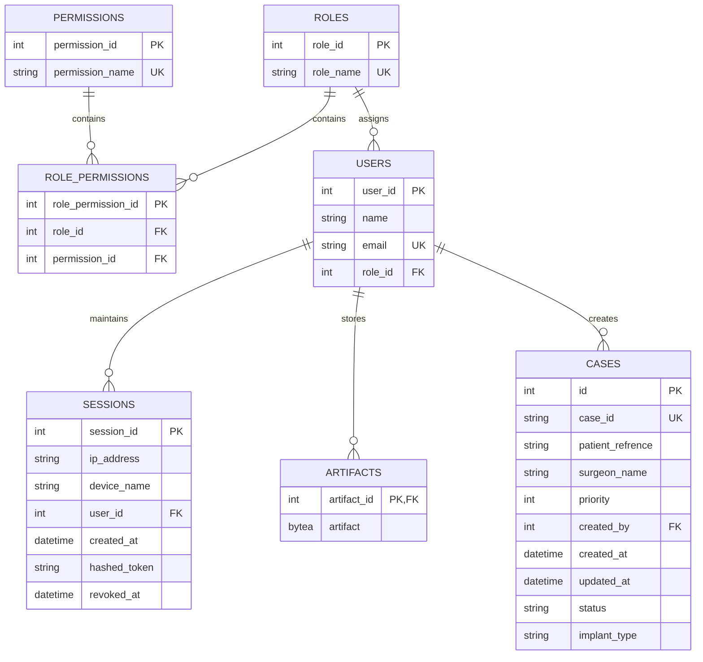

# Database Schema Specification

## 1. Entity Relationship Diagram



---

## 2. Table Specifications

### `med_schema.cases`

| Column | Type | Constraints | Description |
| :--- | :--- | :--- | :--- |
| `id` | `INTEGER` | `PRIMARY KEY`, Auto-increment | Internal surrogate primary key. |
| `case_id` | `VARCHAR(50)` | `NOT NULL`, `UNIQUE`, `INDEX` | External clinical case identifier. |
| `patient_refrence` | `VARCHAR(50)` | `NOT NULL` | Patient chart code. |
| `surgeon_name` | `VARCHAR(50)` | `NOT NULL` | Operating surgeon. |
| `priority` | `INTEGER` | `NOT NULL`, Default: `3` | Priority (`1` = High, `2` = Medium, `3` = Low). |
| `status` | `VARCHAR` | `NOT NULL`, Default: `'Draft'` | Status: `Draft`, `Planning`, `In Review`, `Approved`, `Completed`, `Cancelled`. |
| `implant_type` | `VARCHAR(50)` | `NULLABLE` | Implant description. |
| `created_by` | `INTEGER` | `NOT NULL`, `FOREIGN KEY` | Foreign key referencing `med_schema.users.user_id`. |
| `created_at` | `TIMESTAMP` | `DEFAULT now()` | Record creation timestamp. |
| `updated_at` | `TIMESTAMP` | `DEFAULT now()`, on update | Record update timestamp. |

### `med_schema.users`

| Column | Type | Constraints | Description |
| :--- | :--- | :--- | :--- |
| `user_id` | `INTEGER` | `PRIMARY KEY`, Auto-increment | Primary key. |
| `name` | `VARCHAR(50)` | `NOT NULL` | User name. |
| `email` | `VARCHAR(50)` | `NOT NULL`, `UNIQUE` | User email. |
| `role_id` | `INTEGER` | `NOT NULL`, Default: `3` | Foreign key referencing `med_schema.roles.role_id`. |

### `med_schema.artifacts`

| Column | Type | Constraints | Description |
| :--- | :--- | :--- | :--- |
| `artifact_id` | `INTEGER` | `PRIMARY KEY`, `FOREIGN KEY` | References `users.user_id` (`ON DELETE CASCADE`). |
| `artifact` | `BYTEA` | `NOT NULL` | Salted Bcrypt password hash. |

### `med_schema.sessions`

| Column | Type | Constraints | Description |
| :--- | :--- | :--- | :--- |
| `session_id` | `INTEGER` | `PRIMARY KEY`, Auto-increment | Primary key. |
| `ip_address` | `VARCHAR(50)` | `NULLABLE` | Client IP address. |
| `device_name` | `VARCHAR(50)` | `NULLABLE` | Client User-Agent. |
| `user_id` | `INTEGER` | `NOT NULL`, `FOREIGN KEY` | Foreign key referencing `med_schema.users.user_id`. |
| `created_at` | `TIMESTAMP` | `DEFAULT now()` | Session creation timestamp. |
| `hashed_token` | `VARCHAR(500)` | `NOT NULL` | Session token hash. |
| `revoked_at` | `TIMESTAMP` | `NULLABLE` | Revocation timestamp. |

### `med_schema.roles`, `permissions`, and `role_permissions`

- **Roles**:
  - `4`: `superuser`
  - `5`: `admin`
  - `6`: `user`
- **Permissions**:
  - `1`: `read`
  - `2`: `create`
  - `3`: `update`
  - `4`: `delete`
  - `5`: `create_admin`
- **Role Permissions Mapping**:
  - `superuser (4)` $\rightarrow$ `read`, `create`, `update`, `delete`, `create_admin`
  - `admin (5)` $\rightarrow$ `read`, `create`, `update`, `delete`
  - `user (6)` $\rightarrow$ `read`

---

## 3. Database Migrations

Apply migrations:
```bash
alembic upgrade head
```
